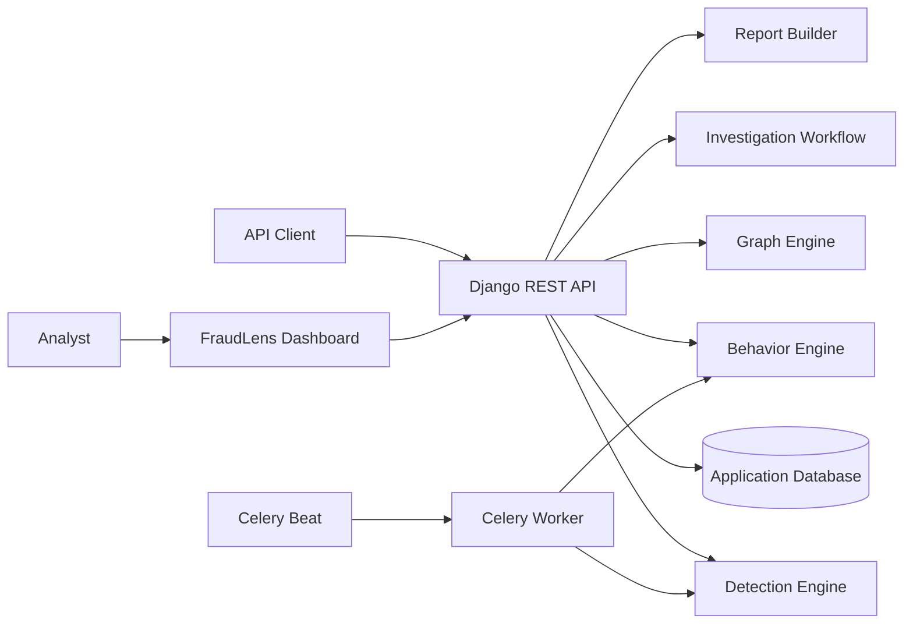
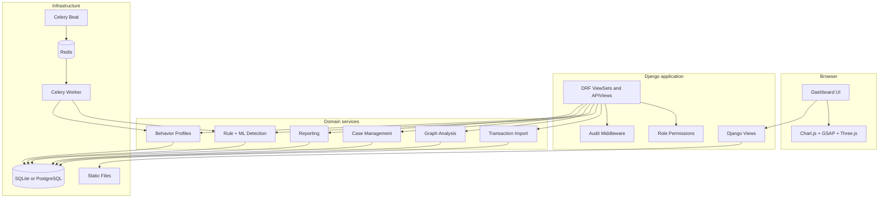
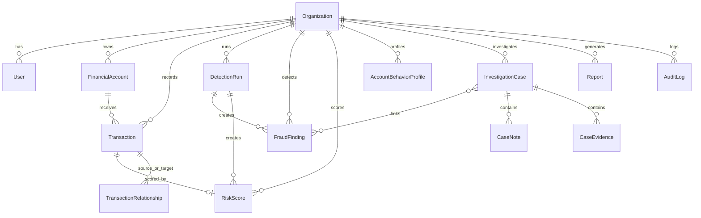
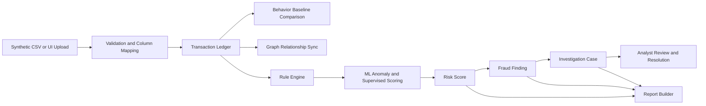
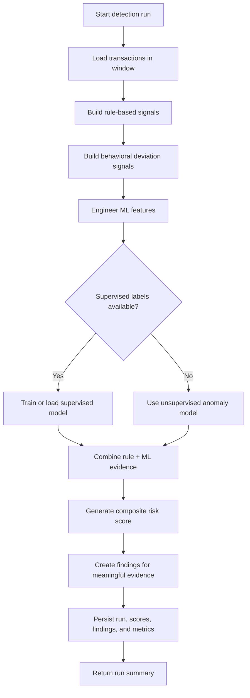
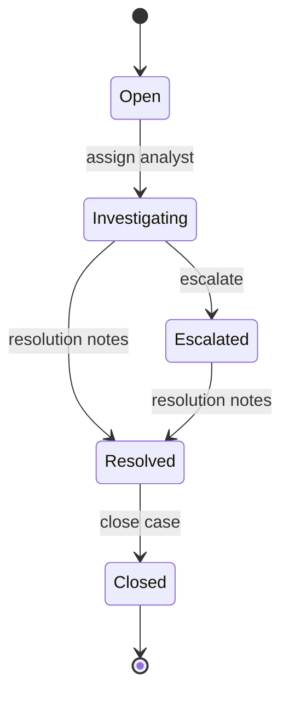
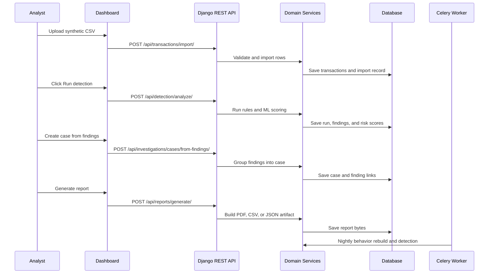
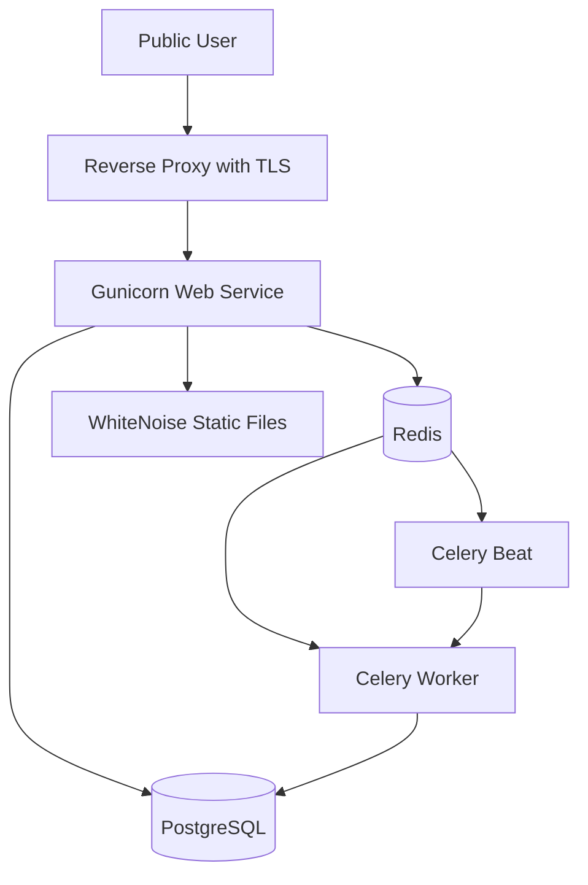
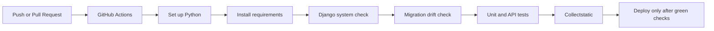

# FraudLens — Professional Project Guide

FraudLens is an AI-powered financial fraud detection and transaction intelligence platform built with Django. It is designed for safe synthetic demonstration, internal decision support, research, and portfolio-grade deployment documentation.

This repository contains one deployable Django project inside `FRAUD-LENS/`.

**Author:** n j bala manikantan  
**License:** MIT  
**Repository:** `https://github.com/Njbalamani/FRAUD-LENS`

---

## 1. Executive summary

| Item | Detail |
| --- | --- |
| Project name | FraudLens |
| Repository folder | `FRAUD-LENS/` |
| Primary framework | Django with Django REST Framework |
| Data mode | Synthetic by default |
| Detection approach | Rules, Isolation Forest, supervised model, optional XGBoost, SHAP-ready explanations |
| Intelligence layers | Behavior profiling, NetworkX graph analysis, case management, reporting |
| User interface | Premium responsive dashboard with Chart.js, GSAP, and Three.js |
| Workers | Celery worker and Celery beat with nightly scheduled tasks |
| Database | SQLite for local demo, PostgreSQL-ready configuration |
| License | MIT, copyright n j bala manikantan |

FraudLens does **not** connect to real banking systems, does **not** execute financial transactions, and does **not** automatically freeze, block, or deny accounts. Every risk score is advisory and requires human review.

---

## 2. Documentation index

| Document | Purpose |
| --- | --- |
| `docs/API.md` | Complete REST endpoint reference and CSV import contract |
| `docs/ARCHITECTURE.md` | Layered architecture and component responsibilities |
| `docs/ER_DIAGRAM.md` | Entity relationship notes |
| `docs/MODEL_CARD.md` | Model purpose, metrics, limitations, and ethics |
| `docs/SECURITY.md` | Security posture, data handling, and threat considerations |
| `docs/DEPLOYMENT.md` | Production deployment checklist and operational guidance |
| `README.md` | This professional project guide |

---

## 3. Professional folder structure

```text
FRAUD-LENS/
├── .github/
│   └── workflows/
│       └── ci.yml
├── apps/
│   ├── accounts/
│   │   ├── management/commands/
│   │   │   ├── generate_synthetic_dataset.py
│   │   │   └── seed_demo.py
│   │   ├── migrations/
│   │   ├── admin.py
│   │   ├── apps.py
│   │   ├── models.py
│   │   ├── serializers.py
│   │   ├── tests.py
│   │   ├── urls.py
│   │   └── views.py
│   ├── behavior/
│   │   ├── migrations/
│   │   ├── services.py
│   │   ├── tasks.py
│   │   ├── models.py
│   │   ├── serializers.py
│   │   ├── views.py
│   │   └── urls.py
│   ├── core/
│   │   ├── context_processors.py
│   │   ├── middleware.py
│   │   ├── permissions.py
│   │   ├── throttling.py
│   │   ├── signals.py
│   │   ├── utils.py
│   │   ├── views.py
│   │   └── urls.py
│   ├── dashboard/
│   │   ├── views.py
│   │   └── tests.py
│   ├── detection/
│   │   ├── ml.py
│   │   ├── services.py
│   │   ├── tasks.py
│   │   ├── models.py
│   │   ├── serializers.py
│   │   ├── views.py
│   │   └── urls.py
│   ├── graph/
│   │   ├── services.py
│   │   ├── views.py
│   │   └── urls.py
│   ├── investigations/
│   │   ├── services.py
│   │   ├── models.py
│   │   ├── serializers.py
│   │   ├── views.py
│   │   └── urls.py
│   ├── reports/
│   │   ├── services.py
│   │   ├── models.py
│   │   ├── serializers.py
│   │   ├── views.py
│   │   └── urls.py
│   └── transactions/
│       ├── services.py
│       ├── synthetic.py
│       ├── models.py
│       ├── serializers.py
│       ├── views.py
│       └── urls.py
├── datasets/
│   ├── transactions_synthetic.csv
│   └── models/
├── docs/
│   ├── API.md
│   ├── ARCHITECTURE.md
│   ├── ER_DIAGRAM.md
│   ├── MODEL_CARD.md
│   ├── SECURITY.md
│   └── DEPLOYMENT.md
├── fraudlens/
│   ├── celery.py
│   ├── settings.py
│   ├── urls.py
│   ├── asgi.py
│   └── wsgi.py
├── static/
│   ├── css/fraudlens.css
│   ├── js/app.js
│   ├── js/network.js
│   └── favicon.svg
├── templates/
│   ├── base.html
│   ├── dashboard.html
│   ├── transactions.html
│   ├── network.html
│   ├── investigations.html
│   ├── reports.html
│   ├── login.html
│   ├── 403.html
│   ├── 404.html
│   ├── 500.html
│   └── partials/report_metrics.html
├── .env.example
├── .gitignore
├── Dockerfile
├── docker-compose.yml
├── LICENSE
├── manage.py
└── requirements.txt
```

### Application responsibility table

| Application | Responsibility |
| --- | --- |
| `accounts` | Organizations, users, roles, token authentication, demo seeding |
| `core` | Audit logs, permissions, throttling, health, API root, schema, search, error pages |
| `transactions` | Ledger, protected CSV import, masking, summaries, import history |
| `detection` | Rules, machine learning, risk scoring, findings, explanations, model metrics |
| `behavior` | Account baselines, deviation analysis, scheduled baseline rebuilds |
| `graph` | NetworkX graph construction, clusters, paths, relationship sync |
| `investigations` | Cases, notes, evidence, assignment, closure, case creation from findings |
| `reports` | PDF, CSV, and JSON report generation and download |
| `dashboard` | Server-rendered pages and analyst-facing UI context |
| `fraudlens` | Project settings, URL root, ASGI/WSGI, Celery application and beat schedule |

---

## 4. Technology stack

| Layer | Technology | Purpose |
| --- | --- | --- |
| Backend | Django, Django REST Framework | Web application and REST API |
| Database | SQLite local, PostgreSQL production | Relational persistence |
| Async | Celery, Redis, Celery beat | Background detection and scheduled rebuilds |
| Data | pandas, numpy | Dataset construction and feature handling |
| Detection | scikit-learn, optional XGBoost | Anomaly and supervised scoring |
| Explainability | SHAP-ready helpers, feature importance | Human-readable model reasoning |
| Graph | NetworkX | Connected components, hubs, shortest paths |
| Reporting | ReportLab, CSV, JSON | Evidence artifacts |
| UI | HTML5, CSS3, JavaScript | Premium responsive dashboard |
| Visualization | Chart.js, GSAP, Three.js | Charts, motion, and 3D network |
| Web server | Gunicorn | Production WSGI serving |
| Static files | WhiteNoise | Static file serving |
| CI | GitHub Actions | Checks, migration drift, tests, static collection |

---

## 5. System diagrams

### 5.1 System context



### 5.2 Container architecture



### 5.3 Entity relationship diagram



### 5.4 End-to-end data flow



### 5.5 Detection workflow



### 5.6 Investigation lifecycle



### 5.7 Analyst sequence



### 5.8 Deployment architecture



### 5.9 CI/CD workflow



---

## 6. Install requirements

| Requirement | Recommended version | Required for |
| --- | --- | --- |
| Python | 3.11+ recommended | Local development and runtime |
| pip | Latest | Package installation |
| Git | Latest | Repository cloning |
| Django | `>=5.1,<6.2` | Web framework |
| djangorestframework | `>=3.15,<4.0` | REST API |
| django-filter | `>=24.3` | API filtering |
| celery | `>=5.4,<6.0` | Async and scheduled tasks |
| redis | `>=5.0,<6.0` | Celery broker and result backend |
| psycopg2-binary | `>=2.9,<3.0` | PostgreSQL driver |
| gunicorn | `>=22.0` | Production WSGI server |
| whitenoise | `>=6.7,<7.0` | Static file serving |
| numpy | `>=1.26,<3.0` | Numerical operations |
| pandas | `>=2.2,<3.0` | Data handling |
| scikit-learn | `>=1.5,<2.0` | Machine learning |
| networkx | `>=3.3,<4.0` | Graph analysis |
| reportlab | `>=4.2,<5.0` | PDF reports |
| joblib | `>=1.4` | Model persistence |
| XGBoost | `>=2.1,<4.0` | Optional supervised booster |
| shap | `>=0.45` | Explainability helpers |

Optional local infrastructure:

| Tool | Use |
| --- | --- |
| Docker Desktop | One-command PostgreSQL, Redis, web, worker, and beat stack |
| PostgreSQL | Production-grade relational database |
| Redis | Celery broker and result backend |

---

## 7. Local installation

### 7.1 Windows PowerShell

```powershell
git clone https://github.com/Njbalamani/FRAUD-LENS.git
cd FRAUD-LENS\FRAUD-LENS
py -m venv .venv
.\.venv\Scripts\Activate.ps1
python -m pip install --upgrade pip
pip install -r requirements.txt
copy .env.example .env
python manage.py migrate
python manage.py generate_synthetic_dataset
python manage.py seed_demo
python manage.py runserver
```

Open `http://127.0.0.1:8000/`.

### 7.2 macOS or Linux

```bash
git clone https://github.com/Njbalamani/FRAUD-LENS.git
cd FRAUD-LENS/FRAUD-LENS
python3 -m venv .venv
source .venv/bin/activate
python -m pip install --upgrade pip
pip install -r requirements.txt
cp .env.example .env
python manage.py migrate
python manage.py generate_synthetic_dataset
python manage.py seed_demo
python manage.py runserver
```

### 7.3 Demo users

| Username | Password | Role |
| --- | --- | --- |
| `fraud-admin` | `FraudLensDemo!` | Administrator |
| `fraud-analyst` | `FraudLensDemo!` | Analyst |
| `fraud-viewer` | `FraudLensDemo!` | Viewer |

Change these credentials before any non-demo use.

---

## 8. Environment configuration

Copy `.env.example` to `.env` and adjust values.

| Variable | Default | Purpose |
| --- | --- | --- |
| `FRAUDLENS_SECRET_KEY` | development key | Django secret; replace in production |
| `FRAUDLENS_DEBUG` | `true` | Development debug mode |
| `FRAUDLENS_ALLOWED_HOSTS` | `localhost,127.0.0.1` | Allowed hostnames |
| `FRAUDLENS_MODE` | `synthetic` | Data mode |
| `FRAUDLENS_ENABLE_LIVE_DATA` | `false` | Live-data guard; keep false |
| `FRAUDLENS_MAX_UPLOAD_MB` | `5` | CSV upload size limit |
| `FRAUDLENS_API_THROTTLE_RATE` | `300/min` | API throttling policy |
| `FRAUDLENS_DB_ENGINE` | SQLite | Django database backend |
| `FRAUDLENS_DB_NAME` | `db.sqlite3` | Database name or path |
| `FRAUDLENS_DB_USER` | `fraudlens` | PostgreSQL user |
| `FRAUDLENS_DB_PASSWORD` | `change-me` | PostgreSQL password |
| `FRAUDLENS_DB_HOST` | `localhost` | PostgreSQL host |
| `FRAUDLENS_DB_PORT` | `5432` | PostgreSQL port |
| `FRAUDLENS_DB_SSLMODE` | `prefer` | PostgreSQL SSL mode |
| `FRAUDLENS_CELERY_BROKER_URL` | `redis://localhost:6379/0` | Celery broker |
| `FRAUDLENS_CELERY_RESULT_BACKEND` | `redis://localhost:6379/1` | Celery results |
| `FRAUDLENS_CELERY_TASK_ALWAYS_EAGER` | `false` | Run Celery tasks inline when true |
| `FRAUDLENS_BASELINE_WINDOW_DAYS` | `30` | Behavior baseline window |
| `FRAUDLENS_AMOUNT_Z_THRESHOLD` | `3.0` | Amount anomaly threshold |
| `FRAUDLENS_FREQUENCY_Z_THRESHOLD` | `2.5` | Frequency anomaly threshold |
| `FRAUDLENS_HIGH_RISK_THRESHOLD` | `75` | High-risk score cutoff |
| `FRAUDLENS_ENABLE_XGBOOST` | `true` | Optional XGBoost usage when installed |
| `FRAUDLENS_ENABLE_SHAP` | `true` | Optional SHAP explanation features |
| `FRAUDLENS_LOG_LEVEL` | `INFO` | Logging level |

---

## 9. Command reference

### 9.1 Daily development commands

| Command | Purpose |
| --- | --- |
| `python manage.py runserver` | Start local development server |
| `python manage.py check` | Run Django system checks |
| `python manage.py test --verbosity 1` | Run complete test suite |
| `python manage.py makemigrations --check --dry-run` | Detect migration drift |
| `python manage.py collectstatic --noinput` | Collect static assets |
| `python -c "from fraudlens.celery import app; print(sorted(app.conf.beat_schedule))"` | Verify Celery beat schedule |

### 9.2 Data and demo commands

| Command | Purpose |
| --- | --- |
| `python manage.py generate_synthetic_dataset` | Generate `datasets/transactions_synthetic.csv` |
| `python manage.py seed_demo` | Create organization, users, accounts, transactions, profiles, findings, case, and report |
| `python manage.py seed_demo --transactions 1000 --accounts 12` | Seed a larger synthetic dataset |
| `python manage.py seed_demo --skip-detection` | Seed ledger without running detection |

### 9.3 Docker commands

| Command | Purpose |
| --- | --- |
| `docker compose up --build -d` | Start web, PostgreSQL, Redis, Celery worker, and beat |
| `docker compose logs -f web` | Follow web logs |
| `docker compose logs -f celery` | Follow worker logs |
| `docker compose logs -f beat` | Follow beat logs |
| `docker compose exec web python manage.py migrate` | Apply migrations in container |
| `docker compose exec web python manage.py seed_demo` | Seed containerized demo data |
| `docker compose down` | Stop the stack |

### 9.4 Token authentication command

```bash
curl -X POST http://127.0.0.1:8000/api/accounts/token/ \
  -H "Content-Type: application/json" \
  -d "{\"username\":\"fraud-admin\",\"password\":\"FraudLensDemo!\"}"
```

Use the returned token as:

```text
Authorization: Token <token>
```

---

## 10. Analyst workflows

| Workflow | UI entry point | API entry point | Result |
| --- | --- | --- | --- |
| Import transactions | Transactions page CSV upload | `POST /api/transactions/import/` | Validated ledger rows and import record |
| Run detection | Dashboard “Run detection” | `POST /api/detection/analyze/` | Detection run, findings, risk scores |
| Review risk trends | Dashboard risk trend chart | `GET /api/detection/explain/` | Visual and explainability context |
| Inspect network | Network page Three.js graph | `GET /api/graph/graph/` | Nodes, edges, clusters, paths |
| Create case from findings | Investigation page triage action | `POST /api/investigations/cases/from-findings/` | Case linked to selected findings |
| Assign or close case | Investigation API/admin | `POST /api/investigations/cases/{id}/assign/`, `close/` | Case lifecycle progression |
| Generate report | Reports page report builder | `POST /api/reports/generate/` | PDF, CSV, or JSON artifact |
| Download report | Reports table download link | `GET /api/reports/download/{id}/` | Report file response |
| Search records | API and admin | `GET /api/search/?q=<term>` | Cross-entity search results |

---

## 11. API quick reference

| Area | Endpoint | Description |
| --- | --- | --- |
| Core | `GET /api/` | API root and endpoint index |
| Core | `GET /api/schema/` | Lightweight endpoint schema |
| Health | `GET /health/` | Status, version, counters, database check |
| Auth | `POST /api/accounts/token/` | Obtain API token |
| Auth | `GET /api/accounts/me/` | Current user |
| Transactions | `GET /api/transactions/transactions/` | Masked ledger |
| Transactions | `GET /api/transactions/summary/` | Aggregates and distributions |
| Transactions | `POST /api/transactions/import/` | Multipart CSV import |
| Detection | `POST /api/detection/analyze/` | Run detection |
| Detection | `GET /api/detection/explain/` | Global explanation and metrics |
| Detection | `GET /api/detection/findings/` | Fraud findings |
| Behavior | `GET /api/behavior/profiles/` | Baseline profiles |
| Behavior | `POST /api/behavior/rebuild/` | Rebuild profiles |
| Graph | `GET /api/graph/graph/` | Graph payload |
| Graph | `GET /api/graph/clusters/` | Suspicious clusters |
| Investigations | `GET /api/investigations/cases/` | Investigation cases |
| Investigations | `POST /api/investigations/cases/from-findings/` | Case from findings |
| Reports | `POST /api/reports/generate/` | Generate report |
| Reports | `GET /api/reports/download/{id}/` | Download report |

Full details are in `docs/API.md`.

---

## 12. Testing and verification

| Check | Command | Expected result |
| --- | --- | --- |
| System check | `python manage.py check` | No issues |
| Migration drift | `python manage.py makemigrations --check --dry-run` | No changes detected |
| Tests | `python manage.py test --verbosity 1` | All tests pass |
| Static files | `python manage.py collectstatic --noinput` | Static files collected |
| JavaScript syntax | `node --check static/js/app.js` | No output on success |
| Health smoke | `curl http://127.0.0.1:8000/health/` | JSON with `status: ok` |

GitHub Actions CI runs the Django checks, migration drift check, tests, and static collection on pushes and pull requests.

---

## 13. Model evaluation and explainability

| Metric or artifact | Purpose |
| --- | --- |
| Precision | Measures how many flagged items were relevant |
| Recall | Measures how many relevant items were found |
| F1-score | Balanced precision and recall summary |
| Confusion matrix | Shows true/false positives and negatives |
| ROC-AUC | Ranking quality where labels are sufficient |
| Feature importance | Shows which engineered signals influenced the model |
| Transaction explanation | Explains a specific score for analyst review |
| Model card | Documents limitations, ethics, and intended use |

Model outputs are advisory. False positives can waste analyst time; false negatives can miss suspicious behavior. Human review is mandatory.

---

## 14. Security and ethics

| Concern | Control in FraudLens |
| --- | --- |
| Sensitive identifiers | Masked in UI and API responses |
| CSV ingestion | Size limit, validation, rejection summary, duplicate handling |
| Authorization | Role-based analyst, admin, and viewer permissions |
| Audit trail | Middleware and signal-based audit logs |
| Live data | Disabled by default with explicit environment guard |
| Automated freezing | Not implemented and prohibited by design |
| Production headers | HSTS, nosniff, same-origin referrer and opener policies |
| Custom error pages | Branded 403, 404, and 500 responses |
| Report access | Organization-scoped report list and download |

See `docs/SECURITY.md` and `docs/MODEL_CARD.md` for deeper guidance.

---

## 15. Production deployment checklist

| Step | Action |
| --- | --- |
| 1 | Set `FRAUDLENS_DEBUG=false` |
| 2 | Generate a long random `FRAUDLENS_SECRET_KEY` |
| 3 | Set exact `FRAUDLENS_ALLOWED_HOSTS` |
| 4 | Keep `FRAUDLENS_MODE=synthetic` unless a reviewed live-data program exists |
| 5 | Keep `FRAUDLENS_ENABLE_LIVE_DATA=false` |
| 6 | Use PostgreSQL through environment variables |
| 7 | Terminate TLS at a trusted reverse proxy |
| 8 | Run `python manage.py migrate --noinput` on each release |
| 9 | Run `python manage.py collectstatic --noinput` on each release |
| 10 | Run checks and tests before release |
| 11 | Run one or more Celery workers |
| 12 | Run Celery beat for nightly detection and behavior rebuilds |
| 13 | Monitor `/health/` |
| 14 | Back up database, evidence, and generated model artifacts |
| 15 | Review audit logs and rotate credentials on a fixed schedule |

---

## 16. Long-term roadmap

| Phase | Focus | Planned outcome |
| --- | --- | --- |
| Phase 1 | Foundation | Complete Django project, synthetic data, role-based access, API, and premium dashboard |
| Phase 2 | Intelligence | Rules, ML scoring, behavior profiles, graph analysis, explainability, and model metrics |
| Phase 3 | Analyst workflow | Case creation from findings, CSV upload UI, report builder, and auditability |
| Phase 4 | Operations | Celery beat, Docker stack, CI, production headers, error pages, and deployment guide |
| Phase 5 | Quality | Expanded tests, coverage reporting, contract tests, and performance benchmarks |
| Phase 6 | Governance | Model approval workflow, data retention controls, and review sign-off records |
| Phase 7 | Scale | Partitioned ledger, async batch ingestion, search indexing, and horizontal workers |
| Phase 8 | Evaluation | Drift monitoring, threshold tuning, false-positive review loops, and versioned model registry |

---

## 17. Troubleshooting

| Symptom | Likely cause | Resolution |
| --- | --- | --- |
| Login page redirects incorrectly | `LOGIN_URL` or session issue | Confirm browser cookies and `python manage.py check` |
| CSV import rejects every row | Header mismatch | Provide `column_mapping` or use canonical CSV headers |
| Detection explains no model metrics | Insufficient labeled data | Use synthetic labels from demo data or provide reviewed labels |
| XGBoost is skipped | Package not installed | Install requirements or set `FRAUDLENS_ENABLE_XGBOOST=false` |
| Celery tasks do not run | Redis unavailable | Start Redis or use `FRAUDLENS_CELERY_TASK_ALWAYS_EAGER=true` for local testing |
| Static assets look stale | Collected files outdated | Run `python manage.py collectstatic --noinput` |
| Health endpoint degraded | Database unavailable | Check database settings and connectivity |

---

## 18. Author and license

**FraudLens** was built and documented by **n j bala manikantan**.

MIT License. See `LICENSE` in this folder and in the repository root.

```text
Copyright (c) 2026 n j bala manikantan
```
