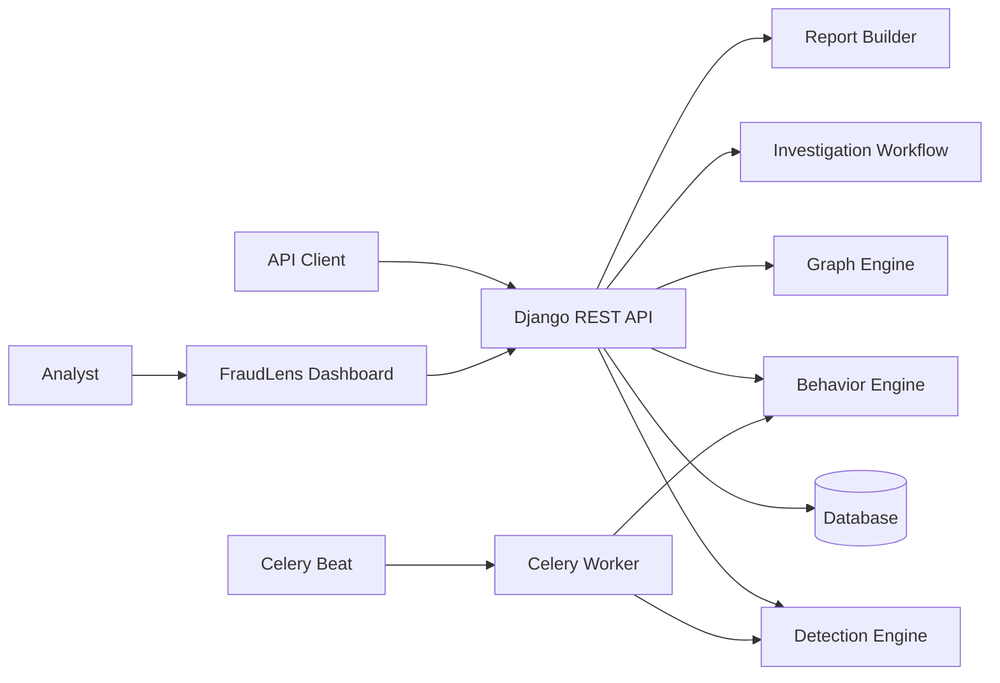
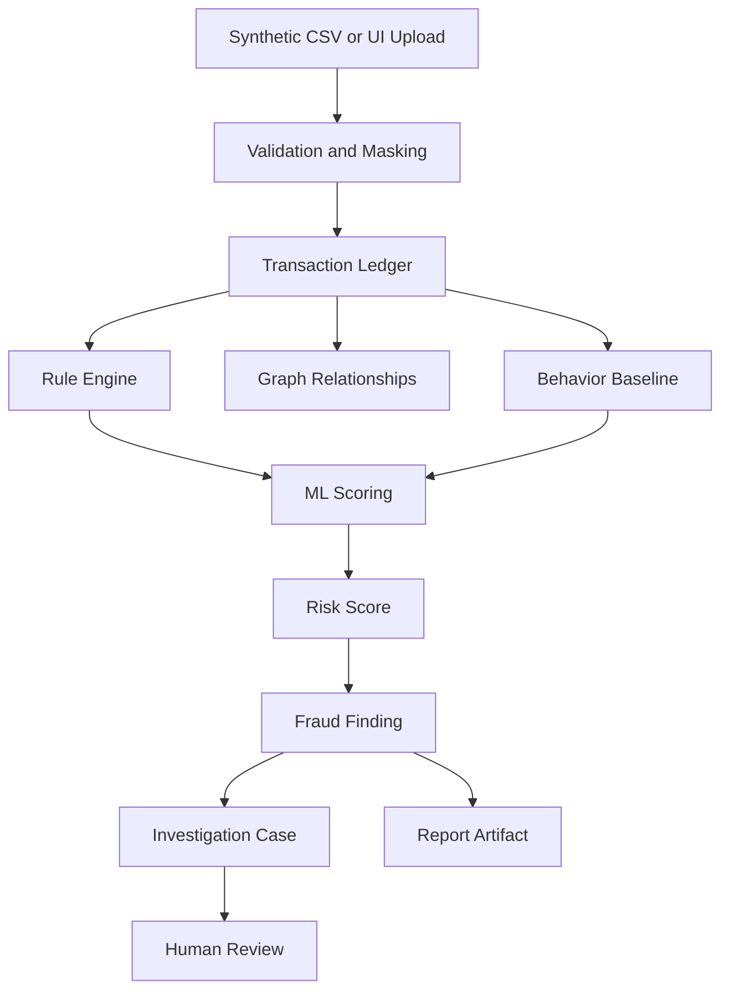
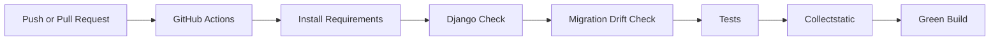

<div align="center">


# FRAUD-LENS

### AI-powered fraud detection and transaction intelligence, engineered for safe synthetic demonstration

**Author:** n j bala manikantan  
**License:** MIT  
**Publication snapshot:** 26/11/2026

</div>

---

## Table of contents

- [Executive summary](#executive-summary)
- [At a glance](#at-a-glance)
- [Core capabilities](#core-capabilities)
- [Technology stack](#technology-stack)
- [Architecture](#architecture)
- [Repository structure](#repository-structure)
- [Quick start](#quick-start)
- [Verification](#verification)
- [Documentation](#documentation)
- [Security and ethics](#security-and-ethics)
- [Roadmap](#roadmap)
- [Author and license](#author-and-license)

---

## Executive summary

FRAUD-LENS is a portfolio-grade Django application for exploring financial fraud detection workflows without touching real banking systems. It combines a transaction ledger, rule and machine-learning detection, behavioral baselines, graph intelligence, investigation cases, reporting, and a premium analyst dashboard.

The repository is intentionally published with a clean boundary:

```text
FRAUD-LENS/                    # GitHub repository root
├── FRAUD-LENS/                # complete deployable Django project
├── LICENSE                    # MIT license with author attribution
└── README.md                  # repository landing page
```

The complete technical guide, including diagrams, workflow tables, command references, and long-term planning, lives in [`FRAUD-LENS/README.md`](FRAUD-LENS/README.md).

---

## At a glance

| Dimension | Detail |
| --- | --- |
| Application type | fraud detection and transaction intelligence platform |
| Default data mode | synthetic only |
| Backend | Django, Django REST Framework |
| Intelligence | rules, Isolation Forest, supervised model, optional XGBoost |
| Explainability | feature importance, transaction-level explanations, model metrics |
| Behavioral analysis | account baselines for amount, time, device, counterparty, and location |
| Network analysis | NetworkX clusters, hubs, relationships, and shortest paths |
| Analyst workflow | case creation, assignment, notes, evidence, resolution |
| Reporting | PDF, CSV, and JSON artifacts |
| UI stack | HTML, CSS, JavaScript, Chart.js, GSAP, Three.js |
| Async processing | Celery worker and Celery beat |
| Database | SQLite for local demo, PostgreSQL-ready production configuration |
| CI | GitHub Actions checks, tests, migration drift, static collection |
| Owner | n j bala manikantan |

---

## Core capabilities

| Capability | What it delivers |
| --- | --- |
| Transaction ledger | masked account and counterparty data with validated CSV ingestion |
| Detection engine | deterministic rules combined with anomaly and supervised scoring |
| Risk scoring | composite scores with high-risk thresholding and advisory interpretation |
| Behavior profiles | per-account baselines and deviation explanations |
| Transaction network | interactive 3D graph with clusters and path tracing |
| Investigation center | finding-to-case workflow with notes, evidence, and closure notes |
| Report builder | scoped PDF, CSV, and JSON report generation and download |
| Premium dashboard | glassmorphism layout, animated reveals, charts, and responsive tables |
| Operations | Celery schedules, Docker stack, health checks, audit logs, and CI |

---

## Technology stack

| Layer | Selected technologies |
| --- | --- |
| Application | Django, Django REST Framework, django-filter |
| Data | pandas, numpy, scikit-learn, optional XGBoost, SHAP-ready helpers |
| Graph | NetworkX |
| Reporting | ReportLab, CSV, JSON |
| Persistence | SQLite, PostgreSQL via `psycopg2-binary` |
| Async | Celery, Redis, Celery beat |
| Serving | Gunicorn, WhiteNoise |
| Frontend | HTML5, CSS3, JavaScript, Chart.js, GSAP, Three.js |
| Quality | Django checks, migration checks, unit tests, API tests, static collection |
| Delivery | Docker Compose, GitHub Actions |

---

## Architecture

### System context



### Detection and investigation flow



### Delivery pipeline



---

## Repository structure

| Path | Purpose |
| --- | --- |
| [`FRAUD-LENS/README.md`](FRAUD-LENS/README.md) | complete professional project guide |
| [`FRAUD-LENS/fraudlens/`](FRAUD-LENS/fraudlens/) | settings, URLs, ASGI/WSGI, Celery beat schedule |
| [`FRAUD-LENS/apps/`](FRAUD-LENS/apps/) | domain apps for accounts, core, transactions, detection, behavior, graph, investigations, reports, dashboard |
| [`FRAUD-LENS/docs/`](FRAUD-LENS/docs/) | API, architecture, ER, model card, security, and deployment documents |
| [`FRAUD-LENS/templates/`](FRAUD-LENS/templates/) | dashboard, login, report, network, and error templates |
| [`FRAUD-LENS/static/`](FRAUD-LENS/static/) | CSS and JavaScript assets |
| [`FRAUD-LENS/datasets/`](FRAUD-LENS/datasets/) | synthetic transaction dataset and generated model artifacts |
| [`FRAUD-LENS/.github/workflows/ci.yml`](FRAUD-LENS/.github/workflows/ci.yml) | CI workflow |
| [`LICENSE`](LICENSE) | MIT license with author attribution |

---

## Quick start

### Windows PowerShell

```powershell
git clone https://github.com/Njbalamani/FRAUD-LENS.git
cd FRAUD-LENS\FRAUD-LENS
py -m venv .venv
.\.venv\Scripts\Activate.ps1
python -m pip install --upgrade pip
pip install -r requirements.txt
copy .env.example .env
python manage.py migrate
python manage.py generate_synthetic_dataset
python manage.py seed_demo
python manage.py runserver
```

### macOS and Linux

```bash
git clone https://github.com/Njbalamani/FRAUD-LENS.git
cd FRAUD-LENS/FRAUD-LENS
python3 -m venv .venv
source .venv/bin/activate
python -m pip install --upgrade pip
pip install -r requirements.txt
cp .env.example .env
python manage.py migrate
python manage.py generate_synthetic_dataset
python manage.py seed_demo
python manage.py runserver
```

### Docker Compose

```bash
docker compose up --build -d
docker compose exec web python manage.py migrate
docker compose exec web python manage.py generate_synthetic_dataset
docker compose exec web python manage.py seed_demo
```

Open `http://127.0.0.1:8000/`.

| Username | Password | Role |
| --- | --- | --- |
| `fraud-admin` | `FraudLensDemo!` | Administrator |
| `fraud-analyst` | `FraudLensDemo!` | Analyst |
| `fraud-viewer` | `FraudLensDemo!` | Viewer |

Change demo credentials before any non-demonstration use.

---

## Verification

| Check | Command |
| --- | --- |
| System validation | `python manage.py check` |
| Migration drift | `python manage.py makemigrations --check --dry-run` |
| Tests | `python manage.py test --verbosity 1` |
| Static files | `python manage.py collectstatic --noinput` |
| JavaScript syntax | `node --check static/js/app.js` |
| Celery schedule | `python -c "from fraudlens.celery import app; print(sorted(app.conf.beat_schedule))"` |

---

## Documentation

| Document | Description |
| --- | --- |
| [Project guide](FRAUD-LENS/README.md) | diagrams, workflows, install requirements, commands, API, roadmap |
| [API reference](FRAUD-LENS/docs/API.md) | REST endpoints and CSV import contract |
| [Architecture](FRAUD-LENS/docs/ARCHITECTURE.md) | layered architecture and component responsibilities |
| [ER diagram](FRAUD-LENS/docs/ER_DIAGRAM.md) | entity relationships and data model notes |
| [Model card](FRAUD-LENS/docs/MODEL_CARD.md) | metrics, explainability, limitations, and ethics |
| [Security](FRAUD-LENS/docs/SECURITY.md) | controls, threat considerations, and data handling |
| [Deployment](FRAUD-LENS/docs/DEPLOYMENT.md) | production checklist and operational guidance |

---

## Security and ethics

> FRAUD-LENS runs in synthetic mode by default. It does not connect to real banking systems, execute financial transactions, or automatically freeze, block, or deny accounts. Risk scores are advisory and require human review.

| Control | Implementation |
| --- | --- |
| Identifier privacy | account, counterparty, and device masking |
| Upload safety | size limits, validation, duplicate handling, rejection summaries |
| Access control | admin, analyst, and viewer roles |
| Auditability | audit middleware, signals, and admin audit log view |
| Live-data guard | explicit `FRAUDLENS_ENABLE_LIVE_DATA` flag, false by default |
| Production headers | HSTS, nosniff, and same-origin referrer/opener policies |

---

## Roadmap

| Phase | Focus |
| --- | --- |
| Foundation | Django project, synthetic data, roles, API, and dashboard |
| Intelligence | detection models, behavior profiles, graph analysis, explanations |
| Analyst workflow | CSV upload, case creation from findings, report builder |
| Operations | Celery beat, Docker, CI, production headers, error pages |
| Quality | coverage, contract tests, benchmarks, and performance profiling |
| Governance | model approval, retention controls, and review sign-off records |
| Scale | partitioned ledger, async batch ingestion, search indexing |
| Evaluation | drift monitoring, threshold tuning, and model registry |

---

## Author and license

<div align="left">

| Item | Detail |
| --- | --- |
| Author | **n j bala manikantan** |
| Project | FRAUD-LENS |
| License | MIT |
| Copyright | Copyright © 2026 n j bala manikantan |
| Repository | `https://github.com/Njbalamani/FRAUD-LENS` |

See [`LICENSE`](LICENSE) for the full MIT license text.

</div>
